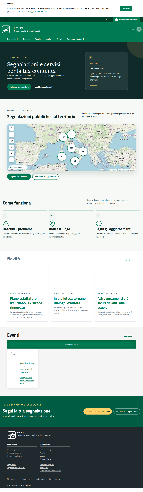

# Manuale utente tema Sixteen

Integra il [manuale actor-oriented](../manuale-uso-attori.md). Sixteen è il tema front office attivo e rende CMS, autenticazione e flussi FixCity.

## Attori e uso

Visitatore: pagine pubbliche e autenticazione. Utente: area personale e segnalazioni autorizzate. Gruppo/team: viste rese disponibili dai moduli. Admin e super-admin: backoffice Filament separato dal tema.

Il routing è governato da Folio/CMS e `PageSlugMiddleware`; il tema non sostituisce policy o Actions.

## Evidenza visuale reale

Screenshot reale del tema attivo.
